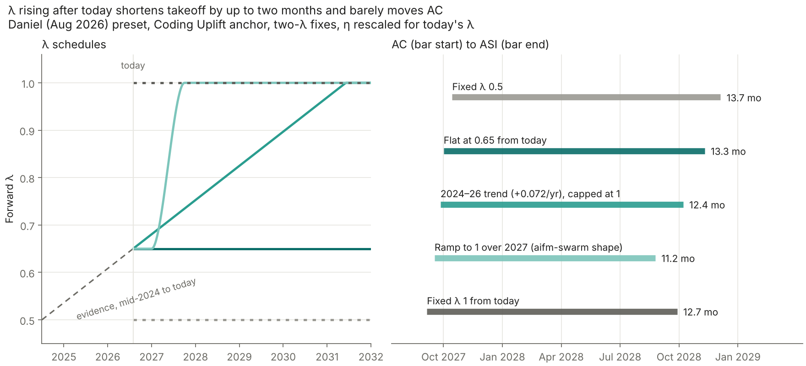

# Rising-λ AI Futures Model

A small variant of the public [AI Futures Model](https://github.com/AI-Futures-Project/aifm-public) that uses one parallelization penalty λ for the past and a separate one for the future, and lets the forward λ rise over time. It is the [two-λ fixes](https://github.com/JulianBradshaw/aifm-lambda-fixes) plus a λ schedule: with the schedule flat it is exactly the two-λ fixes, and with the forward λ also at the preset's 0.5 it is upstream. The upstream model is preserved unchanged in `upstream/` as a git submodule pinned to commit `1c40ecdb246c25980515441a66571931c5604e11` (MIT license in `upstream/LICENSE`); clone with `git clone --recurse-submodules`. This variant is MIT-licensed (`LICENSE`).

**[Run it in the browser](web/README.md)** · [design of the λ schedule](DESIGN.md) · [rising-λ results](outputs/RISING.md) · [two-λ results for the Daniel preset](outputs/REPORT.md) · [the same change as a patch to upstream](upstream-patch/) · [figures of how λ moves the model's timelines](figures/)

## λ rising over time

The two-λ fixes below hold the forward λ fixed from today on. The evidence summarised in the forthcoming write-up puts λ at about 0.5 for the teams behind the 2024 calibration and about 0.65 for small AI teams today, so λ may keep rising as coordination improves. Here the forward λ can follow a schedule after today: it starts at `lambda_forward` and moves to `lambda_end` over `ramp_years` from `ramp_start`, along a straight line or a smoothstep S-curve.

λ(t) then takes the place of the forward λ in the fixed-λ formula, X0^0.5 (X/X0)^λ(t), so a rise applies to all coding labor growth since today: better coordination also helps the agents already running, not only those added after the rise. With a gradual ramp serial labor changes gradually too; [DESIGN.md](DESIGN.md#λ-rising-over-time) has the details and the alternative of applying each λ only to labor added while it is in force. η is rescaled for today's forward λ (0.5/0.65) and not for the later rise, since the rise is better coordination rather than a change in how much parallel labor compute buys. History and every calibrated quantity are unchanged, and a flat schedule takes the original code path, so it reproduces the two-λ fixes exactly.

Daniel 08/16/26 preset, Coding Uplift anchor, η rescaled linearly:

| Forward λ after today | λ at AC | λ at ASI | AC | ASI | Takeoff, AC to ASI |
| --- | --- | --- | --- | --- | --- |
| Fixed 0.5 (the fixes at upstream's λ) | 0.50 | 0.50 | Oct 2027 | Dec 2028 | 13.7 mo |
| Flat at 0.65 | 0.65 | 0.65 | Oct 2027 | Nov 2028 | 13.3 mo |
| The 2024–26 trend continued (+0.072 a year), capped at 1 | 0.73 | 0.81 | Sep 2027 | Oct 2028 | 12.4 mo |
| 0.65 to 1 during 2027 (the earlier swarm repo's ramp: smoothstep from January over 9 months) | 1.00 | 1.00 | Sep 2027 | Aug 2028 | 11.2 mo |
| Fixed 1 from today, for reference | 1.00 | 1.00 | Sep 2027 | Sep 2028 | 12.7 mo |



A rising λ shortens takeoff by at most about 2.1 months against λ held at 0.65 and moves AC by at most 2 weeks, because λ only acts on labor growth after today and the trend reaches only about 0.8 by ASI. With η rescaled linearly the fast ramp reaches ASI about 5 weeks before a fixed λ of 1, because its η is rescaled for 0.65 rather than 1. With η not rescaled its ASI is about a week later than a fixed λ of 1, but its takeoff is still slightly shorter (10.7 against 11.0 months) because it reaches AC about two weeks later; see [outputs/RISING.md](outputs/RISING.md). Regenerate with `python -m two_lambda.rising_sweep` (writes `outputs/RISING.md`, `outputs/rising_lambda.csv` and the figure).

The rest of this README describes the two-λ fixes, which are unchanged.

## Why two λs

λ converts parallel coding labor into serial labor: N times more parallel labor is worth N^λ times more serial labor. The AI Futures Model uses one λ for historical human teams and future AI swarms alike, so changing it does more than change how well swarms parallelize. Two calibrations of the past move with it:

1. **Reading today's coding uplift.** The model backs today's measured serial coding uplift (2× in August 2026 for the Daniel preset) out into an automation level. At higher λ the same 2× implies less parallel AI labor today, so the model starts from less automation and reaches the automated coder (AC) later.
2. **Refitting returns to software research.** r_software is scaled so that software efficiency grew 1.0 OOM a year in 2024. At higher λ, the growth in human researchers before 2024 explains more of that progress, so the fit lowers r_software (3.15 at λ 0.5, 2.86 at λ 1), which weakens the feedback loop during takeoff.

Both are side effects of using one λ for history and forecast. With the Coding Uplift anchor they outweigh the direct benefit: raising λ from 0.5 to 1 lengthens takeoff (AC to ASI) from 13.7 to 18.2 months.

## The variant

History and calibration keep the preset's λ (0.5). Today's automation fraction (60%), today's parallel AI labor (4.0× human) and r_software (3.146) are therefore the same at every forward λ. From the calibration date t0 on, a forward λ applies to growth in coding labor:

    serial coding labor = norm · X0^0.5 · (X / X0)^λ_forward      for t ≥ t0

where X is parallel coding labor and X0 its value at t0. Everything else is upstream's own code: the run is upstream's trajectory until t0, and after t0 upstream's rate function with this coding labor substituted.

Two further λ uses are adjusted for the forward λ:

- **η**, the coding automation efficiency improvement (OOMs per progress-year), was estimated at λ 0.5. It is rescaled linearly, η · (0.5/λ_forward), which keeps its serial-equivalent rate fixed. Upstream uses η^(0.5/λ), which is the conversion for a growth factor rather than a count of OOMs. Both, and no rescaling, are available as `eta_rescale='linear' | 'power' | 'none'`.
- The **Maximum Serial Coding Labor Multiplier** keeps its serial meaning: its parallel-labor cap is converted with the same mapping.

With the forward λ equal to the preset's, the variant returns upstream's trajectory exactly.

## Results

Daniel 08/16/26 preset, Coding Uplift anchor, native present day; single runs at preset medians, not forecasts.

| Takeoff, AC to ASI | λ 0.5 | λ 0.65 | λ 0.8 | λ 1 |
| --- | --- | --- | --- | --- |
| Two-λ, η linear (default) | 13.7 mo | 13.3 mo | 13.0 mo | 12.7 mo |
| Two-λ, η power | 13.7 mo | 13.3 mo | 12.8 mo | 12.3 mo |
| Two-λ, η not rescaled | 13.7 mo | 12.3 mo | 11.5 mo | 11.0 mo |
| Single λ (upstream) | 13.7 mo | 14.5 mo | 15.8 mo | 18.2 mo |

With two λs, higher λ shortens takeoff and brings AC slightly earlier (October to September 2027 at λ 1), instead of delaying AC by eight months. Most of the gap between the η rows is by design: the linear rescale holds η's serial rate fixed, so the forward λ adds nothing to the part of labor growth that comes from η. Whether that is right depends on how much of η's evidence measured faster serial work rather than cheaper copies; the "not rescaled" row is the other bound. The other anchors and presets are in [outputs/REPORT.md](outputs/REPORT.md); regenerate with `python -m two_lambda`.

## The same change as a patch to upstream

`upstream-patch/` makes the change directly in upstream's code instead of wrapping it, to show its size. Counting changed or added lines of Python, excluding comments:

| File | Change | Lines |
| --- | --- | --- |
| `1-calibration-lambda.diff` | New parameter `calibration_parallel_penalty` (0.5) | 1 |
| `2-uplift-backcalculation.diff` | Solve the automation schedule from today's uplift at the calibration λ | 3 |
| `3-history-refit.diff` | Historical labor, the r_software fit and the research-stock start at the calibration λ; forward λ for labor growth after today | 14 |
| `4-eta-linear.diff` | η · (0.5/λ) instead of η^(0.5/λ) | 1 |

The patched model agrees with this package to within a week on AC and ASI dates and 0.1 month on takeoff (`tests/test_upstream_patch.py`). The small differences come from the patch rescaling η for the whole run rather than only after today. Reported metrics that convert labor with λ (for example the serial coding labor multiplier) are not patched; they do not affect the trajectory.

## Run

Python 3.14 is recommended, matching upstream:

```sh
git clone --recurse-submodules https://github.com/JulianBradshaw/aifm-rising-lambda
cd aifm-rising-lambda
python -m venv .venv
.venv/bin/python -m pip install -r requirements.txt
.venv/bin/python -m two_lambda      # writes outputs/REPORT.md and outputs/results.csv
.venv/bin/python -m two_lambda.rising_sweep    # writes outputs/RISING.md, rising_lambda.csv and the figure (needs matplotlib)
.venv/bin/python -m pytest
```

On Windows, use `.venv\Scripts\python.exe`.

```python
from two_lambda.model import Variant, simulate, upstream_single_lambda

result = simulate(Variant(lambda_forward=1.0))  # eta_rescale='linear' by default
rising = simulate(Variant(lambda_forward=0.65, lambda_end=1.0, ramp_start=2027.0, ramp_years=0.75,
                          ramp_shape='smoothstep'))  # λ 0.65 today, 1 by October 2027
print(result['milestones'], result['takeoff_months'])
print(upstream_single_lambda(1.0)['takeoff_months'])  # the unmodified model at λ 1
```

`simulate` also takes `anchor` (`uplift-solved`, `time-horizon`, `revenue`, `eci`), `preset` (`daniel-08-16-26`, `eli-08-16-26`, `brendan-08-16-26`), `present_day` (None for the preset's own) and `overrides`, a tuple of (parameter, value) pairs passed to the calibration, such as `(('inf_labor_asymptote', 100),)`.

## Files

- `DESIGN.md`: the λ schedule and its extra solver state.
- `two_lambda/model.py`: calibration, the forward coding labor and its λ schedule, milestones.
- `two_lambda/rising_sweep.py`: the λ schedules and figure.
- `two_lambda/presets.py`: reads the pinned presets from `upstream/constants/parameters.ts`.
- `two_lambda/__main__.py`: the comparison report.
- `upstream-patch/`: the same change as diffs against `upstream/progress_model`.
- `tests/`: reproduction of upstream at λ 0.5, pinned calibration, the λ schedule (flat is unchanged; a rise applies to all growth since today), the patch, and the browser entry point.
- `web/`: the browser page.
- `figures/`: scripts and data for the λ charts, for the unmodified model and the two-λ variant (`python figures/make.py`).
